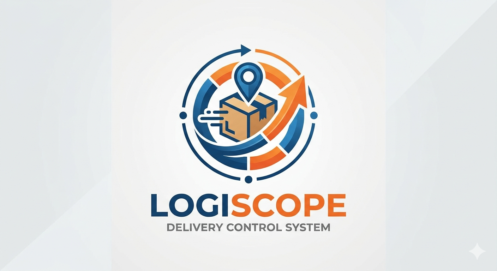

# Logiscope · Controle de Entregas



Sistema de gestão de entregas de uma operação logística com frota própria: TMS,
rastreamento GPS em tempo real, ocorrências, indicadores e uma "torre de
controle" que junta tudo numa tela. É usado no dia a dia pela expedição,
pelos motoristas e pela gestão.

> Versão pública para portfólio: pessoas, placas, endereços de servidor e
> identificadores de rastreadores foram trocados por dados fictícios. Anotações
> internas ficaram de fora.

## O que o sistema faz

- **TMS**: programação das viagens, saída da fábrica, docas, agendamento nas lojas,
  CT-e e reconciliação com a planilha que a operação ainda usa.
- **Rastreamento da frota** juntando três plataformas de rastreador (T4S,
  Satfleet e um GPSWOX), escolhendo a melhor fonte por veículo e recuperando
  sinais perdidos.
- **Previsão de chegada** por loja a partir do GPS, cercas geográficas e
  histórico de visitas; detecção automática de chegada e saída de cada loja.
- **Torre de controle 360°**: painel ao vivo com mapa, atrasos e alertas.
- **Ocorrências** de entrega, de motorista e de loja, com responsáveis, gravidade,
  tratativa e causa raiz; **ranking** e pontuação das equipes.
- **Checklist pelo WhatsApp**: importa a conversa exportada do grupo, separa as
  fotos por motorista e cruza com as viagens do TMS.
- **Análises com IA** (Gemini / OpenAI / Claude) sobre os números do período, com
  os valores calculados pelo sistema, nunca inventados pelo modelo.
- Relatório semanal, tendências, escalas, documentos de motoristas, controle de
  veículos e usuários com perfis de acesso.

## Destaques técnicos

- **Node.js + Express** e PostgreSQL, com front-end em JavaScript puro
  (27 abas, gráficos com Chart.js e mapas com Leaflet/OpenStreetMap).
- **Coleta de GPS na nuvem**: uma Edge Function na Supabase (Deno) busca e guarda
  as posições mesmo com o servidor da empresa desligado.
- **361 testes** com `node:test`, incluindo os cálculos de GPS, previsão,
  importações e as telas. Os testes que precisam de PostgreSQL de verdade são
  pulados quando não há banco.
- Integrações com sistemas que não têm API pública, com sessão e reautenticação
  automáticas.
- Configuração só por variáveis de ambiente (`.env.example` lista os nomes).

## Rodando localmente

Requisitos: Node.js 24 e PostgreSQL.

```bash
npm ci
cp .env.example .env    # preencha DB_HOST, DB_USER, DB_PASSWORD...
npm start               # http://localhost:3000
```

Testes:

```bash
node --test back/test/*.test.cjs
```

Variáveis de banco e integrações: [.env.example](.env.example).

## Tecnologias

Node.js · Express · PostgreSQL · Supabase (Edge Functions, Deno) · JavaScript ·
Chart.js · Leaflet · Render · APIs de IA (Gemini, OpenAI, Claude)
